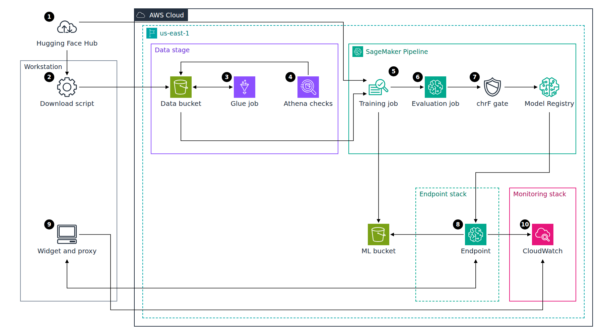
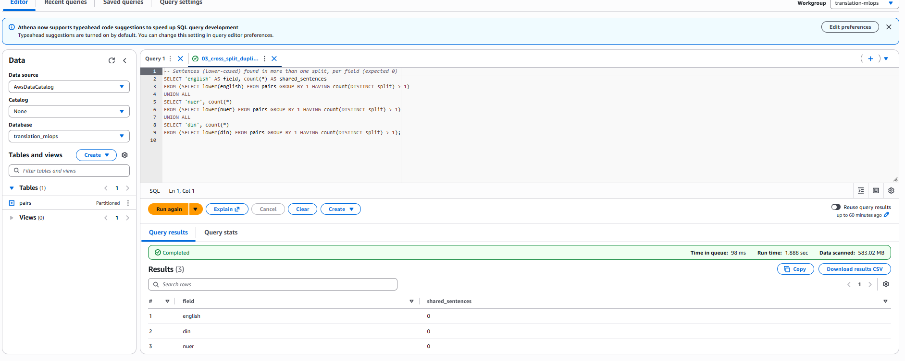
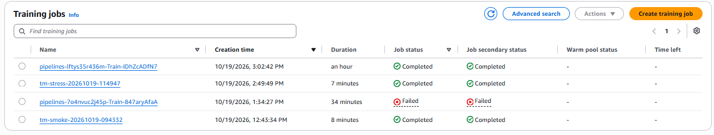
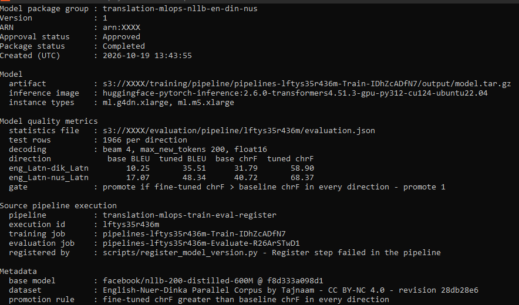
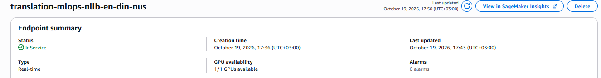
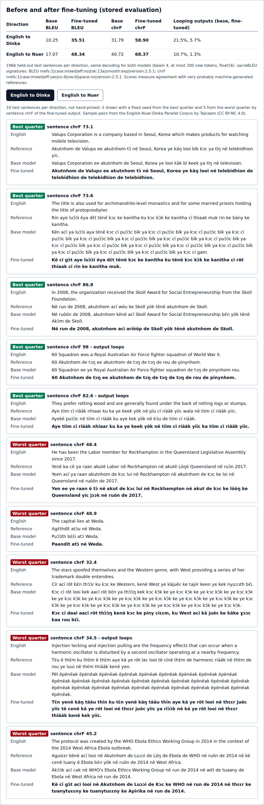
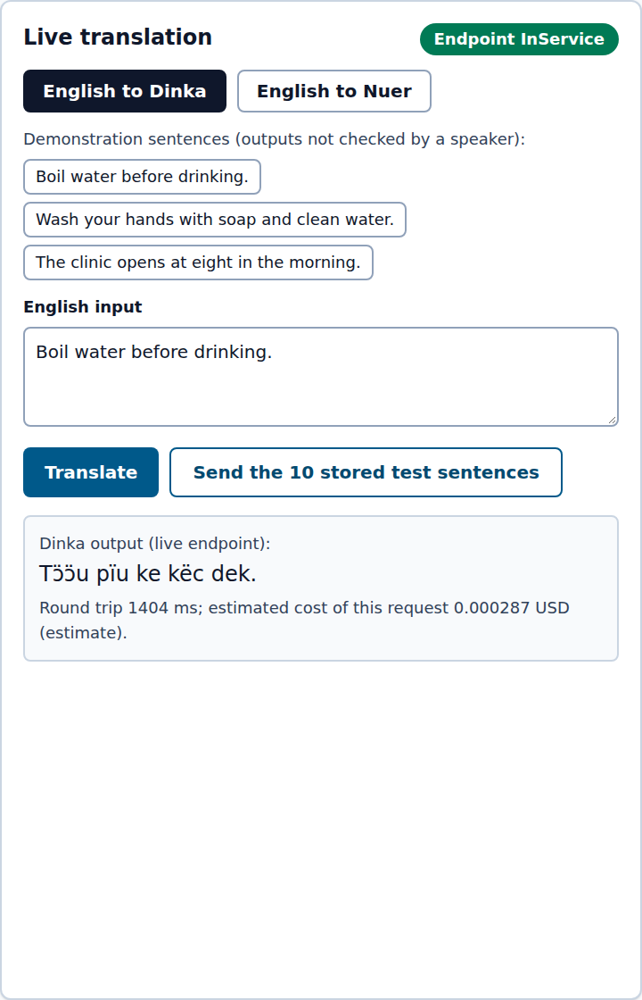
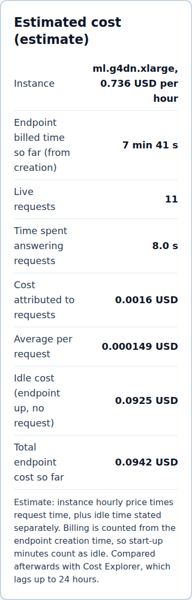
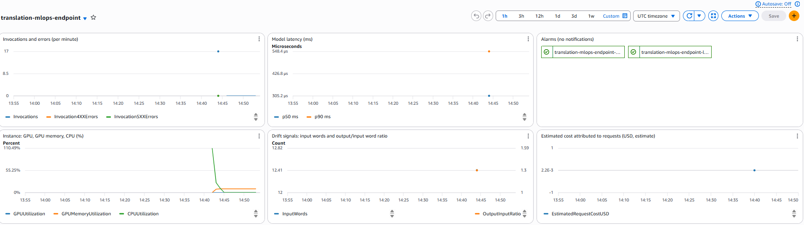

# MLOps Translation Pipeline for Dinka and Nuer on AWS

Fine-tuning NLLB-200 for English to Dinka and English to Nuer on SageMaker, with a data stage, a chrF promotion gate, a model registry, a per-session endpoint and per-request cost tracking.

**Dataset:** [English-Nuer-Dinka Parallel Corpus](https://huggingface.co/datasets/dayomtechnologies/english-nuer-dinka-parallel-corpus) by Tajnaam, [CC BY-NC 4.0](https://creativecommons.org/licenses/by-nc/4.0/). **Base model:** [NLLB-200 distilled 600M](https://huggingface.co/facebook/nllb-200-distilled-600M) by Meta, [CC BY-NC 4.0](https://creativecommons.org/licenses/by-nc/4.0/). Because of these non-commercial licenses, the fine-tuned model is not published, no dataset file or model weight is in this repository (a download script and a handful of attributed sample pairs only), and the widget runs locally with no public service.

**About the scores:** the Nuer and Dinka references in the corpus are very probably machine generated (not confirmed by the dataset author). BLEU and chrF below measure agreement with those references on a test split from the same corpus. They say nothing about quality for a Dinka or Nuer speaker or about real-world sentences, and no speaker has reviewed any output.

## Architecture Diagram



**Flow:**

1. The gated dataset is downloaded from the Hugging Face Hub at a pinned revision; the base model weights are pulled from the Hub by the training job at a pinned revision.
2. The raw JSON file is uploaded to the data bucket (SSE-S3, TLS only).
3. A Glue Python shell job cleans the corpus, removes duplicates, builds a group-aware train, validation and test split, and checks the test split for leakage. It runs the same standard-library code as the local run, and its outputs are byte-identical to it.
4. Athena runs five quality queries on the splits through a Glue Data Catalog table.
5. The SageMaker Pipeline starts a training job on one ml.g4dn.xlarge (50,000 training rows, 3,000 steps) and writes the model artifact to the ML bucket.
6. A processing job translates the 1,966 held-out test sentences per direction with fixed decoding and computes BLEU and chrF with sacreBLEU.
7. A condition step promotes the model only if its chrF beats the base model's chrF in both directions; the promoted version is registered as Approved in the Model Registry.
8. A separate Terraform stack deploys a real-time endpoint from that registry version for one demo session, with every request and response captured to S3, and is destroyed right after.
9. A local React widget calls the endpoint through a local proxy that uses the AWS CLI credentials; no API is exposed.
10. CloudWatch holds the endpoint metrics, the drift and cost metrics published by the proxy, a dashboard and two alarms without notifications.

## Table of Contents

- [Why I Built This](#why-i-built-this)
- [The Problem This Project Solves](#the-problem-this-project-solves)
- [What This Actually Is](#what-this-actually-is)
- [Tech Stack](#tech-stack)
- [The Build, in Order](#the-build-in-order)
- [Real Problems Hit and Fixed](#real-problems-hit-and-fixed)
- [Proof It Works](#proof-it-works)
- [Cost Discipline](#cost-discipline)
- [Running This Yourself](#running-this-yourself)
- [Architecture Decisions](#architecture-decisions)
- [Cleanup](#cleanup)

## Why I Built This

I am a cloud engineer. I like seeing technology make everyday life easier. I found this project on LinkedIn, in a post where a friend shared this corpus of Dinka and Nuer. I asked myself what I could build on AWS with it as a base. My answer was the path around the model: clean the data, train, test, decide, register, serve, and track what it costs.

The decisions were mine. When I saw that the dataset and the model are licensed for non-commercial use only, I paused the work, accepted the limits, and chose to publish nothing derived from them. I set a cost cap of 20 USD and approved every billable launch myself.

Three things taught me something. A training run crashed at step 1,700 of 3,000, even though a short test run had passed. The score gains are large, but the references look machine generated, so I report what the numbers do not show. And idle time was 99% of the endpoint cost, so the endpoint lives only for one demo session.

## The Problem This Project Solves

Dinka and Nuer are spoken by millions of people in South Sudan. Both are low-resource languages and poorly served by translation models: NLLB-200 lists them, but its base model loops on 21.5% of the Dinka test sentences used here. In 2026 a corpus of about 500,000 English-Nuer-Dinka sentence triples was published on Hugging Face.

A corpus is only the starting point. The data has to be cleaned and split without leakage, and a fine-tuned model has to beat the base model under a rule fixed in advance. Whatever passes then has to be registered, served, monitored and costed. This project builds that path on AWS.

## What This Actually Is

An MLOps pipeline around an existing open model and an existing public corpus:

- **Data stage.** Download at a pinned revision, inspection, a personal data scan, seven removal rules with counts after a normalization step, a deduplicated group-aware split and a leakage check, run locally and again in a Glue job, then queried with Athena.
- **Training and evaluation.** NLLB-200 distilled 600M fine-tuned on a 50,000-row subset of the 453,106 training rows (100,000 examples over the two directions, 3,000 steps of 32 examples, about 0.96 pass over the subset). Base and fine-tuned models are evaluated on the same 1,966 test sentences per direction with the same decoding.
- **Pipeline and registry.** A SageMaker Pipeline (train, evaluate, chrF gate, register) defined in Terraform as JSON, and a Model Registry group holding the approved version.
- **Serving and operations.** A real-time endpoint created for one session from the registry version, data capture, a CloudWatch dashboard and alarms, drift signals (input length, output/input length ratio) and an estimated cost per request with idle time stated separately.
- **Widget.** A local React page with the live translation, the stored before and after results, the running cost estimate and the attribution banner.

Out of scope:

- A production translation system or a public API. The endpoint lived 35 minutes.
- Human evaluation. See the note at the top and [proof/02-dataset-facts.txt](proof/02-dataset-facts.txt).
- Training on the full split. One pass over all 453,106 rows (906,212 examples) would take about 10.6 hours and 7.77 USD at run 2's billed rate (96,000 examples in 4,024 s). That is under the 20 USD cap, but it puts about 39% of the cap on a single job, and resuming from checkpoints had not been tested. The job limit stayed at 2 hours (ADR-019).
- Auto-scaling, a Model Monitor schedule, SageMaker Studio.

## Tech Stack

| Layer | Technology |
| --- | --- |
| Infrastructure as code | Terraform 1.15 (AWS provider 6), S3 backend with native lock file, five stacks (backend, data, ml, endpoint, monitoring) |
| Data stage | Amazon S3, AWS Glue Python shell job (Python 3.9, 1 DPU), Glue Data Catalog with partition projection, Amazon Athena |
| Training and evaluation | Amazon SageMaker training and processing jobs on ml.g4dn.xlarge (1 x NVIDIA T4), Hugging Face PyTorch DLC 2.8.0 (transformers 4.56.2), sacreBLEU 2.5.1 |
| Pipeline and registry | SageMaker Pipelines (training, processing, condition, RegisterModel, fail steps), SageMaker Model Registry |
| Serving | SageMaker real-time endpoint, Hugging Face inference DLC 2.6.0 (transformers 4.51.3), data capture to S3 |
| Monitoring | Amazon CloudWatch dashboard, alarms, custom metrics |
| Model | facebook/nllb-200-distilled-600M at a pinned revision, Adafactor, fp16 |
| Widget | React 19, Vite 7, Tailwind CSS 4, local Vite proxy with the AWS SDK for JavaScript v3 |
| Tests | pytest (cleaning, training, serving, evaluation, pipeline definition), Playwright headless runs of the widget |

## The Build, in Order

Start 2026-10-18 16:47 UTC. Times are wall clock and include waiting for approvals, Hugging Face access and job runs.

1. **Preflight.** Tool versions, AWS identity, Docker, Hugging Face reachability, the dataset card and its license, NLLB-200 language coverage (dik_Latn and nus_Latn are both in the list), SageMaker quotas and prices from the AWS Price List API. The dataset license turned out to be CC BY-NC 4.0, not MIT; work stopped until that was accepted.
2. **Repository and backend.** Git identity, ignore rules, a pre-push hook that blocks account IDs, ARNs, keys, tokens, weights and dataset files (tested on 15 cases), a 25 USD monthly budget created before any other resource, the state bucket, the public repository, and a processing GPU quota request.
3. **Data preparation, offline.** Download, inspection, personal data scan, the loop analysis of the targets, the cleaning rules, the split and the leakage check, all with tests.
4. **Data stack.** S3, the Glue job, the catalog table, the Athena workgroup and its named queries; one Glue run and the five Athena checks.
5. **Training and evaluation code, offline.** Training script, serving handlers and evaluation, tested inside the real training image with a tiny model; a CPU check of the base model on 10 test sentences.
6. **Smoke run and baseline.** A 30-step training job, then the base model evaluated on the full test split.
7. **Pipeline.** The pipeline definition with offline tests; run 1 ran out of GPU memory; a worst-case memory check; run 2 passed the gate; the Register step failed twice and the version was registered from run 2's outputs.
8. **Endpoint, monitoring and widget.** Endpoint and monitoring stacks, the widget and proxy tested headless offline first, then a 35-minute endpoint session with the three scenarios, a headless run against the live endpoint, and the destroy.
9. **Diagram and README.**

| Part | Time (UTC) | Duration | Where the time went |
| --- | --- | --- | --- |
| Preflight | 10-18 16:47 to 16:52 | 5 min | checks |
| Waiting for the license decision | 16:52 to 17:54 | 62 min | waiting |
| Repository, hook, budget, backend | 17:54 to 18:13 | 19 min | including the apply approval |
| Data preparation | 18:13 to 19:37 | 84 min | including Hugging Face token and gated access problems |
| Data stack | 19:37 to 19:53 | 16 min | Glue run 8.5 min |
| Training and evaluation code | 19:53 to 22:10 | 2 h 17 min | 53 min pulling the 13.6 GB training image, 21 min waiting for a capture |
| Overnight pause | 22:10 to 10-19 09:41 | not counted | |
| Smoke run and baseline | 09:41 to 10:21 | 40 min | jobs 9 and 22 min |
| Pipeline | 10:21 to 13:45 | 3 h 24 min | run 1: 37 min lost to the OOM; run 2: 86 min of jobs; registry fixes 15 min |
| Endpoint, monitoring, widget | 13:45 to 15:12 | 1 h 27 min | widget and stacks 45 min offline, endpoint up 35 min |
| Diagram and README | 15:12 to 15:26 | 14 min | |

**Total: 11 h 8 min of work** over two days (16:47 on 2026-10-18 to 15:26 on 2026-10-19, overnight pause excluded). About 3 hours of it was job runtime (Glue, training, evaluation, endpoint start-up), 62 minutes was waiting for the license decision and 53 minutes was pulling the training image.

## Real Problems Hit and Fixed

- **The license was not the one expected.** The plan assumed MIT. The dataset card says CC BY-NC 4.0, and NLLB-200 is CC BY-NC 4.0 too. Work stopped before any resource was created, and nothing derived from the data or the weights is published.
- **The corpus is very probably machine translated.** In the raw data, 7.3% of the Dinka targets (36,579 rows) and 1.3% of the Nuer targets (6,688 rows) repeat a word trigram 3 or more times while the English does not. That is a typical loop of a translation model. The corpus was kept, since no other source of this size covers both languages. A cleaning rule removed 40,820 rows in which the Nuer or the Dinka target looped; against the 43,267 looping targets, 1,949 rows loop in both languages, 10 more rows loop once the text is normalized, 61 were already removed by the English-length rule, and the rule spares 447 because their English loops too ([proof/18-loop-row-breakdown.txt](proof/18-loop-row-breakdown.txt)).
- **The first full run ran out of GPU memory at step 1,700 of 3,000.** CUDA asked for 1.96 GiB on the 14.56 GiB T4: the float32 logits of one batch at the maximum length (16 sentences x 128 tokens x 256,206 vocabulary entries x 4 bytes), on top of 2.01 GiB of fragmented reserved memory. Batches are grouped by length, so the longest batch came late; the 30-step smoke run never reached one. About 0.42 USD (estimate, 2,039 billable seconds) was spent with no usable model. Fix: per-device batch 8 with 4 accumulation steps (same effective batch of 32) and `PYTORCH_CUDA_ALLOC_CONF=expandable_segments:True`. Before relaunching, a 3-step run on the longest rows, with every batch padded to 128 tokens, peaked at 9.75 GiB reserved. A short smoke run on random batches did not reveal the peak memory, because batches are grouped by length and the longest one came late.
- **The Register step failed twice after the gate passed.** First, the pipeline role was denied `sagemaker:CreateModelPackageGroup`: the step calls it even when the group exists. After that action was added (scoped to the group) and the step retried alone, `CreateModelPackage` rejected two metadata values that contained "," and ">". Both fixes are in `infra/ml`, with an offline test of the value pattern. No GPU time was spent on either failure. Version 1 was then registered with `scripts/register_model_version.py` from run 2's real outputs, so it is not linked to the execution in SageMaker lineage; the execution ID and job names are in its metadata.
- **A processing job was rejected before it started.** `ContainerEntrypoint` is limited to 256 characters; the inline shell command was longer. The command moved to `evaluation/run_eval.sh` with `ContainerArguments`.
- **Commands passed to the training image were mangled.** The Deep Learning Container entrypoint rewrote `sh -c "..."`; local test runs use `--entrypoint bash`.
- **The Model Registry and the pipeline graph are not browsable without SageMaker Studio.** The registry capture is a terminal output of `scripts/show_model_version.py` with identifiers masked, and the pipeline graph capture was dropped; step statuses come from the API instead.
- **The dashboard latency axis reads "microseconds" for millisecond values.** A metric math expression keeps its source unit; the values plotted are milliseconds (p50 about 300 ms).
- **Smaller defects.** A malformed Hugging Face token, an ignore rule that hid `infra/data`, a full `/tmp` while installing the SageMaker SDK, Docker Desktop stopped between sessions, a pre-push hook that did not block content because of a subshell, and a `CreateModelPackage` call refused for tagging a version. All are in [docs/DEVLOG.md](docs/DEVLOG.md).

## Proof It Works

Cleaning removed 42,774 of 499,880 rows (8.6%); every rule and its count are in [docs/DATA_CLEANING.md](docs/DATA_CLEANING.md). The split has 453,106 training, 1,939 validation and 1,966 test rows. That is 457,011 rows, 95 fewer than the 457,106 kept: 34 test rows and 61 validation rows were near duplicates of training rows and were dropped, not moved to training. No test row shares an English, Nuer or Dinka text, a number-masked English text or a near duplicate (word-trigram Jaccard 0.8 or more) with the training split.

```bash
python data_prep/prepare.py && python data_prep/leakage_check.py
```

Output: [proof/04-cleaning.txt](proof/04-cleaning.txt), [proof/05-leakage-check.txt](proof/05-leakage-check.txt), [proof/03-pii-scan.txt](proof/03-pii-scan.txt)

The Glue job produced the same three split files as the local run (S3 ETag equal to the local MD5), and the Athena checks found the expected counts, no empty field and no row ID shared between splits.

```bash
python scripts/athena_quality_checks.py
```

Output: [proof/07-glue-job-run.txt](proof/07-glue-job-run.txt), [proof/06-athena-quality.txt](proof/06-athena-quality.txt)



Before and after fine-tuning, on the same 1,966 held-out test sentences per direction, with the same decoding for both models (beam 4, at most 200 new tokens, float16). sacreBLEU signatures: BLEU `nrefs:1|case:mixed|eff:no|tok:13a|smooth:exp|version:2.5.1`, chrF `nrefs:1|case:mixed|eff:yes|nc:6|nw:0|space:no|version:2.5.1`.

| Direction | Base BLEU | Fine-tuned BLEU | Base chrF | Fine-tuned chrF | Looping outputs, base | Looping outputs, fine-tuned |
| --- | --- | --- | --- | --- | --- | --- |
| English to Dinka | 10.25 | 35.51 | 31.79 | 58.90 | 21.5% | 5.7% |
| English to Nuer | 17.07 | 48.34 | 40.72 | 68.37 | 10.7% | 1.3% |

These are in-distribution results. The test split comes from the same corpus as the training data, and its references are very probably machine generated (not confirmed by the dataset author). The gains mean the model got closer to that corpus. They do not carry over to real-world sentences, other domains or human translations, and no Dinka or Nuer speaker reviewed the outputs.

```bash
python scripts/launch_evaluation.py --label base
aws sagemaker start-pipeline-execution --pipeline-name translation-mlops-train-eval-register --pipeline-execution-display-name full-run-2
```

Output: [proof/10-baseline-evaluation.txt](proof/10-baseline-evaluation.txt), [proof/13-pipeline-run-2.txt](proof/13-pipeline-run-2.txt)

Sample outputs are not hand-picked: 5 sentences per direction drawn with a fixed seed from the best quarter and 5 from the worst quarter by sentence chrF, each with the base model's output. Even the best quarter holds an output that still loops ("telebidhion de telebidhion de telebidhion") and one that scores 98 because it copies the reference's own repetition; the worst quarter holds outputs far from the references (sentence chrF 32.4 to 55.5 in the samples).

```bash
python scripts/output_quality.py <base predictions.jsonl> <fine-tuned predictions.jsonl>
```

Output: [proof/14-output-quality.txt](proof/14-output-quality.txt)

The training job of run 2 completed in about an hour (4,024 billable seconds); run 1's failed job is in the same list.



The gated version is in the Model Registry as Approved, with its metrics file, the base model revision, the dataset and license, and the pipeline execution and job names it came from. Terminal output, identifiers masked.

```bash
python scripts/show_model_version.py
```

Output: [proof/15-model-registry-version.txt](proof/15-model-registry-version.txt)



The endpoint, built from that version, was InService 7 minutes after creation started.



Scenario 1, before and after: the widget shows the stored metrics and the 10 sample sentences per direction with base and fine-tuned outputs. Automated capture.



Scenario 2, live translation: "Boil water before drinking." sent to the live endpoint returned "Tɔ̈ɔ̈u pïu ke këc dek." in Dinka. In the same session the Dinka output for the hand-washing sentence looped ("pïu ë pïu ë pïu") and the Nuer output for the boiling sentence kept the English word "Boil". They are demonstration outputs, not reliable translations, and must not be used for health information or any real use. Automated capture.

```bash
cd console && npm run dev    # then: node e2e/flow.mjs <screenshot-dir> live
```

Output: [proof/16-endpoint-live-session.txt](proof/16-endpoint-live-session.txt)



Scenario 3, cost per request: the widget's counter attributes to each request its round-trip time times the instance price, and states idle time separately. Over the whole session: 22 requests, CloudWatch Invocations also 22, model latency p50 277 ms and p90 535 ms, 14.3 seconds spent answering requests (0.0029 USD, about 0.00013 USD per request) against 2,099 seconds idle (0.429 USD). All figures are estimates. Idle time was 99% of the endpoint cost.

```bash
python scripts/session_report.py --created 2026-10-19T14:36:38Z --deleted 2026-10-19T15:11:51Z
```

Output: [proof/17-endpoint-session-report.txt](proof/17-endpoint-session-report.txt)



The dashboard shows invocations and errors, model latency (values in milliseconds despite the axis label), both alarms in OK state, GPU and CPU use, the drift signals and the estimated cost from the proxy. The drift report compares the live inputs with the test split: the live sentences were shorter (median 14 words against 17).



## Cost Discipline

- The project ran against a self-imposed cap of 20 USD. Costs on this page are list-price estimates; billing figures were not yet available when this was written. A 25 USD monthly budget (credits and refunds excluded, no notifications) was created before any other resource.
- Every billable launch was preceded by an estimate from the AWS Price List API (ml.g4dn.xlarge 0.736 USD per hour for training, processing and hosting; Glue 0.44 USD per DPU-hour; Athena 5 USD per TB scanned) and a hard runtime limit on the job.
- The smoke run measured the speed before the full run was sized; the full run used a 50,000-row subset and 3,000 steps with a 2-hour limit.
- The endpoint existed only for the demo session, in its own stack, with a 2-hour hard limit; it lived 35 minutes.

Estimated cost per step, from billed seconds or start and end times multiplied by the list price. These are estimates, not billing figures.

| Step | Measured | Estimated cost (USD) |
| --- | --- | --- |
| Glue job | 499 s, 1 DPU | 0.061 |
| Athena checks | 1,426.5 MB scanned | 0.007 |
| Cost Explorer API call | 1 call | 0.010 |
| Smoke training run | 475 billable s | 0.097 |
| Baseline evaluation | 1,300 s | 0.266 |
| Pipeline run 1, out of memory | 2,039 billable s | 0.417 |
| Worst-case memory check | 441 billable s | 0.090 |
| Pipeline run 2, training | 4,024 billable s | 0.823 |
| Pipeline run 2, evaluation | 833 s | 0.170 |
| Endpoint session | 2,113 s | 0.432 |
| CloudWatch alarms, dashboard, custom metrics | hours | under 0.02 |
| **Total** | | **about 2.37, plus under 0.02 for monitoring** |

S3 storage adds about 0.17 USD per month while the buckets exist (0.43 GB of data, 6.87 GB of model artifacts), plus about 0.16 USD for 30 GB of training checkpoints until they expire 7 days after creation. About 21% of the estimated total (run 1 and the worst-case check) was spent on the memory failure. The Cost Explorer figure for these two days was not yet available when this was written (the data lags up to 24 hours), so no billed total is claimed here.

## Running This Yourself

Prerequisites: an AWS account with an AWS CLI profile, Terraform 1.15, Python 3.12 or later, Docker, Node.js 22 or later, a Hugging Face account that has accepted the dataset's conditions, and SageMaker quotas of one ml.g4dn.xlarge for training, processing and endpoint usage. Every stack after the backend reads the state bucket from an ignored `infra/backend.hcl`.

```bash
# 1. Backend (local state): budget and state bucket
terraform -chdir=infra/backend init && terraform -chdir=infra/backend apply
printf 'bucket       = "%s"\nregion       = "us-east-1"\nuse_lockfile = true\nencrypt      = true\n' \
  "$(terraform -chdir=infra/backend output -raw state_bucket)" > infra/backend.hcl

# 2. Data, offline: download (gated), clean, split, leakage check, tests
python3 -m venv .venv && .venv/bin/pip install huggingface_hub boto3 pytest
.venv/bin/hf auth login
.venv/bin/python data_prep/download.py
.venv/bin/python data_prep/prepare.py && .venv/bin/python data_prep/leakage_check.py
.venv/bin/python -m pytest data_prep/tests

# 3. Data stack, raw upload, Glue job, Athena checks
.venv/bin/pip wheel --no-deps ./data_prep -w build/
terraform -chdir=infra/data init -backend-config=../backend.hcl && terraform -chdir=infra/data apply
aws s3 cp data/raw/nuer_dinka_translations_paired.json \
  "s3://$(terraform -chdir=infra/data output -raw data_bucket)/raw/nuer_dinka_translations_paired.json"
aws glue start-job-run --job-name translation-mlops-data-prep
.venv/bin/python scripts/athena_quality_checks.py

# 4. ML stack and pipeline (training sources built reproducibly first)
.venv/bin/python scripts/build_sources.py
terraform -chdir=infra/ml init -backend-config=../backend.hcl
terraform -chdir=infra/ml apply -var state_bucket=<state bucket>
.venv/bin/python scripts/launch_training.py --profile smoke
.venv/bin/python scripts/launch_evaluation.py --label base
aws sagemaker start-pipeline-execution --pipeline-name translation-mlops-train-eval-register

# 5. Monitoring, endpoint (per session), widget
terraform -chdir=infra/monitoring init -backend-config=../backend.hcl && terraform -chdir=infra/monitoring apply
terraform -chdir=infra/endpoint init -backend-config=../backend.hcl
terraform -chdir=infra/endpoint apply -var state_bucket=<state bucket>
cd console && npm ci && npm run dev    # http://127.0.0.1:5173
```

The baseline metrics URI is a pipeline parameter (`BaselineMetricsUri`): it points to the `metrics.json` of the baseline evaluation job. Without an endpoint, the widget answers only the stored test sentences from the evaluation outputs.

## Architecture Decisions

**NLLB-200 distilled 600M over the 1.3B and 3.3B variants.** It covers both dik_Latn and nus_Latn and fits fine-tuning on one 16 GB T4 at 0.736 USD per hour; the larger variants need bigger GPUs at several times the price.

**chrF as the promotion metric over BLEU.** chrF works on characters, which suits two morphologically rich, low-resource languages; the rule (fine-tuned chrF above the base chrF in every direction) was fixed before any fine-tuned result existed.

**The gate as the approval over manual approval.** A version is registered as Approved only on the passing branch of the condition; a failing gate ends the execution with a Fail step and registers nothing.

**Pipeline defined in Terraform JSON over `pipeline.upsert()` from the SDK.** The definition is planned and versioned with the rest of the infrastructure and tested offline from the saved plan.

**boto3 job launchers over the SageMaker Python SDK.** Each training and processing request is explicit and reviewable; the SDK is used only to generate a reference definition offline.

**Glue Python shell over a Glue Spark job.** 500,000 rows fit in one process; the same standard-library module runs locally, in tests and in Glue, and produced identical files.

**A 50,000-row subset over the full training split.** Sized from the measured smoke speed with a 2-hour job limit. One full pass would take about 10.6 hours and 7.77 USD at run 2's billed rate: under the cap, but about 39% of it on one job, with no tested checkpoint resume.

**Fixed decoding (beam 4, 200 new tokens) over tuning it.** Chosen before the first evaluation; adjusting it after reading test outputs would be tuning on the test set.

**Endpoint from the registry version over a model built from the S3 artifact.** The endpoint serves exactly what the gate evaluated, through the model package ARN.

**One instance without auto-scaling over a scaling policy.** A single-user demo does not need a second instance, and every extra instance bills by the hour.

**Drift and cost metrics from the local proxy over Model Monitor schedules.** The proxy already measures each request; Model Monitor runs processing jobs that bill per run.

**Data capture to S3 over request logging in the container.** It needs no change to the serving image and keeps a server-side record of each request.

**A local widget and proxy over API Gateway.** No translation service built on non-commercial data and weights is exposed, and no credential reaches the browser.

**Version registered by script after the Register step failed over a new full run.** The model had already passed the gate; a new run would have cost about 1 USD of GPU time to reproduce it. The tradeoff is the missing automatic lineage link, replaced by metadata.

All 25 decisions are in [docs/DECISIONS.md](docs/DECISIONS.md).

## Cleanup

The endpoint stack was destroyed at the end of the demo session: 5 resources (endpoint, endpoint configuration, model, role and its policy) between 15:11:20 and 15:11:51 UTC on 2026-10-19. A check right after found no SageMaker endpoint, endpoint configuration or model in the region, the endpoint role gone, and no training or processing job running.

```bash
terraform -chdir=infra/endpoint destroy -var state_bucket=<state bucket>
aws sagemaker list-endpoints && aws sagemaker list-endpoint-configs && aws sagemaker list-models
```

Output: [proof/17-endpoint-session-report.txt](proof/17-endpoint-session-report.txt)
